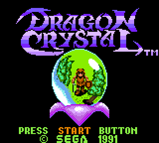
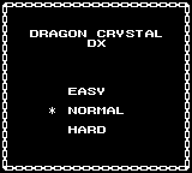
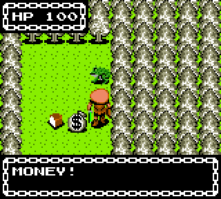
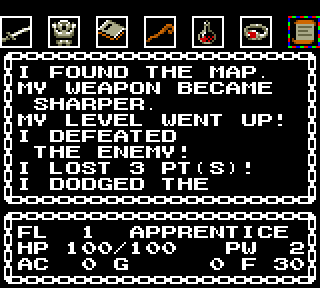
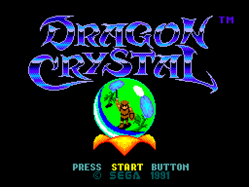
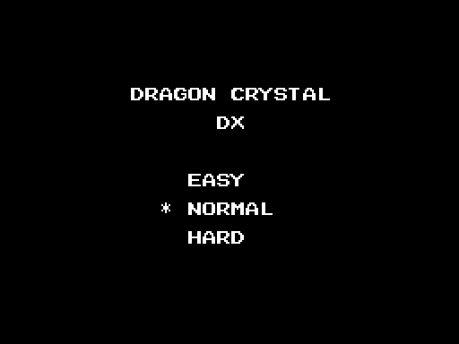
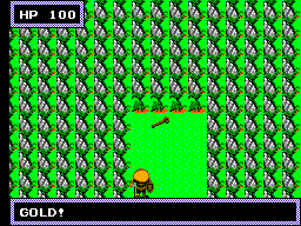
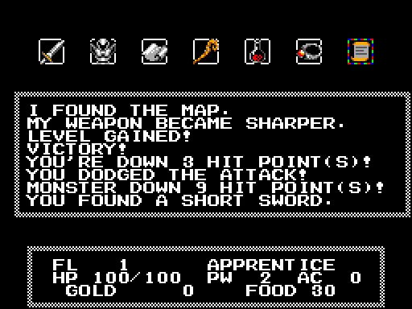

# Dragon Crystal DX

An improvement patch for **Dragon Crystal** (Sega, 1990/1991), the little rogue-like where a boy is
pulled into a crystal ball and must cross 30 random mazes, followed by a dragon egg. Available for the
**Game Gear** and the **Master System** versions.

Dragon Crystal DX keeps the original game intact and adds:

* **bug fixes** for the main bugs of the original (a freeze, absurd damage, rings working when not worn...);
* a **message log** in the inventory: the game keeps the last 14 messages and you can scroll through them;
* a choice of mode at the start of each game: **EASY** for players who never made it to floor 30,
  **NORMAL**, or **HARD**, where death is final;
* on Game Gear, **START opens the inventory**, like in most Game Gear games.

### Game Gear

| | |
|:-:|:-:|
|  |  |
| Title screen (unchanged) | New: EASY, NORMAL or HARD |
|  |  |
| In game | Inventory (START), with the new message log |

### Master System

| | |
|:-:|:-:|
|  |  |
| Title screen (unchanged) | New: EASY, NORMAL or HARD |
|  |  |
| In game | Inventory (button 1), with the new message log |

## Download and apply

No ROM is provided. Pick the patch for your version of the game:

| Patch | Apply to | Size | CRC32 | SHA-1 |
|-------|----------|------|-------|-------|
| [`patch/DragonCrystalDX-GG.ips`](patch/DragonCrystalDX-GG.ips) | Dragon Crystal (USA, Europe).gg | 131 072 | `0EF2ED93` | `6d53f32001d419a5b5e9c16cb62e07e548d2f44a` |
| [`patch/DragonCrystalDX-SMS.ips`](patch/DragonCrystalDX-SMS.ips) | Dragon Crystal (Europe).sms | 131 072 | `9549FCE4` | `021c6983fdab4b0215ca324734deef0d32c29562` |

Use any IPS patcher ([Floating IPS](https://www.romhacking.net/utilities/1040/), Lunar IPS, or the
web-based [Rom Patcher JS](https://www.marcrobledo.com/RomPatcher.js/)), then play the patched ROM in
your favourite emulator or on a flash cartridge.

## What's new

### Controls

| | Original Game Gear | DX Game Gear | Master System (original and DX) |
|---|---|---|---|
| Open the inventory | button 1 | **START** | button 1 |
| Close the inventory | button 1 (on the icons) | button 1 (on the icons) or **START** (anywhere in the menu) | button 1 (on the icons) |
| Speed up the game | hold START | hold **button 1** | fast by default, PAUSE switches fast / normal |
| Action: pick up, search, wait | button 2 | button 2 | button 2 |

The Master System pad has no START button, so the Master System version keeps its original controls.

### Mode select

After the title screen, choose **EASY**, **NORMAL** or **HARD** with UP / DOWN (NORMAL is selected at
first), confirm with button 1 or 2 (or START on Game Gear).

* **NORMAL** is the original game, with the bug fixes and the message log.
* **HARD** is NORMAL without second chances: in the original game, when you die you can buy a
  *continue* with your gold (3 per game). In HARD there is no continue: **death is final**.
* **EASY** is the same game (same maps, monsters, items, fog of war, identification...) with these
  rules relaxed:

| Rule | NORMAL (original) | EASY |
|------|-------------------|------|
| Hunger: 1 food point eaten every... | 10 turns (18 / 6 / 4 with some rings) | 15 turns (27 / 9 / 6) |
| Food found (rations) | +10 to +48 | ×1.5 (max 99) |
| HP regeneration every... | 8 turns (4 with a ring, 2 with HEAL RING) | 5 turns (3 / 2) |
| Damage received from monsters | 100 % | 75 % |
| Special attacks (poison, rust, theft, level / strength / HP drain, fog, confusion) | always | 1 time out of 2 |
| Cursed weapons / armours on the floor | 1 in 16 | 1 in 32 |
| Secret passages (walls to search) | (floor − 3) / 64 per passage | half as many |
| Searching a wall: chance at the n-th try | n / 8 | n / 4 |
| Experience | ×1 | ×1.5 |
| Continues | 3, cost (floor/4 + 1 + continues used) × 100 gold | 5, half price |

### Message log

Messages appear one at a time at the bottom of the screen and vanish on the next step; when several things
happen in one turn, some are easy to miss. Now:

* the inventory has a **7th icon**, a scroll, after the rings: on this tab, the item window widens and
  shows the messages, newest first, exactly as they were displayed in the game;
* **UP / DOWN** scroll through the **last 14 messages** kept by the game;
* the idle prompt (*WHAT SHALL I DO?* / *WHAT SHALL YOU DO?*) is not recorded.

### Bug fixes (all modes)

The two versions share the same code and the same bugs:

| Original bug | Fix |
|--------------|-----|
| **RESHAPE ROD** used on a DRAGON on floor 30 froze the game (it kept looking for another species) | at most 16 tries, then "no effect" |
| A hit with a base damage of 0 (cursed weapon at level 1, thrown book or rod...) could deal **255** damage | it deals 1 |
| **REFLEX POT** and **SHIELD RING** raised the AC shown on the status screen, but did not protect at all | they really reduce the damage received (1 point per point of AC) |
| **WITHER POT** lowered the power bonus instead of the armour bonus | lowers the armour bonus |
| **OGRE RING**, **SHIELD RING** and **MAGIC RING** worked even when not worn (just carried in the first ring slot) | only when worn |
| With exactly 256 HP while starving, the cause of death became "starvation" | fixed (full 16-bit test) |
| At rank 16 (MASTERLORD), every victory gave a level up again, with more PW and HP each time (from 65 535 experience points on Game Gear, 57 386 on Master System) | no more level-up past rank 16 |
| DEATH BLADE: when its cost brought the HP to exactly 0, the death cause was not recorded | recorded |
| The continue counter was not reset after a won game (fewer continues in the next game) | reset for each new game |
| Game Gear typo *I CAN'T CHANGE MY WEPON.* | *MY WEAPON.* |
| Master System: the BLESS SCROLL message was cut: *MY WEAPON BECAME* | *MY WEAPON BECAME SHARPER.* |
| Master System typos *YOU DODGER THE ATTACK!*, *YOU'RE STRENGTH DECREASES!* | *YOU DODGED*, *YOUR STRENGTH* |
